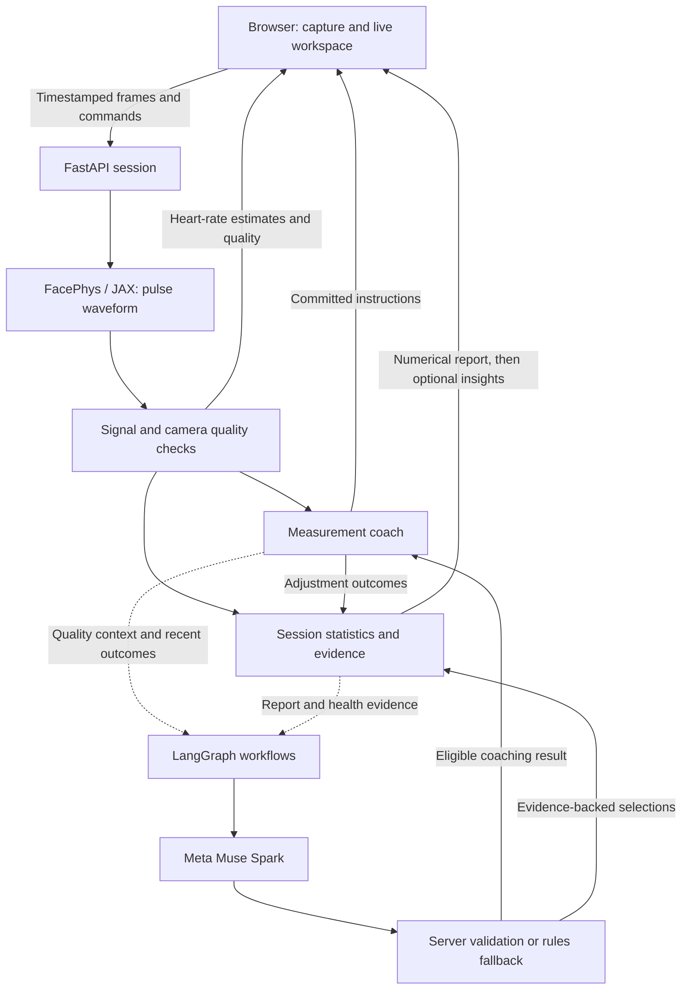
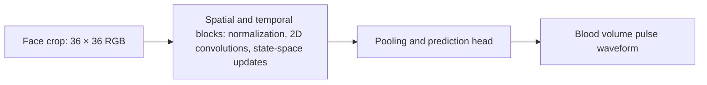

# PulsePilot

Built for the **Meta Global AI Developer Hackathon**.

PulsePilot is a research prototype that estimates your heart rate from webcam video and helps you understand the quality of each measurement. It combines the pretrained FacePhys model with live guidance on lighting, movement, and face position, then produces a report of heart-rate trends, signal quality, and the adjustments made during the session.

Optional Meta Muse Spark assistance runs through three LangGraph workflows: measurement coaching, session analysis, and Health Insights. The sensing pipeline and numerical reports run independently of those model requests, so a slow or unavailable AI service does not stop measurement.

## What you can do

- **Measure with your webcam.** Follow a guided session with an estimated heart rate, a live pulse waveform, and feedback on capture conditions.
- **Adjust your setup.** Receive one instruction at a time, such as changing the lighting or holding still, and review the signal quality before and after each adjustment.
- **Explore the model's attention.** Toggle the face heatmap to see a projection of FacePhys's internal features. It is a model visualization, not a blood-flow measurement.
- **Understand the recording.** Review accepted heart-rate statistics, clearly marked preliminary estimates, quality timelines, and general Health Insights with supporting evidence.
- **Keep a session report.** Export JSON or print the report. Reports remain in browser memory for the current page session and clear on refresh or close.

The capture client and backend also support recorded-video replay and labeled synthetic simulation for development and testing. The current homepage starts live-camera sessions; the replay script below processes recorded video files.

## How it works

The Next.js / React frontend owns camera capture, preview, charts, and session controls. It sends timestamped frames over a WebSocket to a persistent Python / FastAPI service. The service runs FacePhys in JAX, checks the signal and capture conditions, manages coaching, and builds reports.



Each connection owns its session state. The backend permits one real inference session per process and releases its resources when the session finishes or disconnects. Adjustment history stays within the session; there is no persistent user profile or database.

### FacePhys model design

[FacePhys: State of the Heart Learning](https://arxiv.org/abs/2512.06275), by Wang et al. (2025), describes a model that extracts pulse information from small changes in light reflected by the face. Its temporal-spatial state-space duality combines spatial convolutions with an evolving state that carries temporal information between frames.



This simplified schematic follows [Figure 3 and Sections 3.1–3.5 of the paper](https://arxiv.org/html/2512.06275v1#S3). Temporal normalization reduces drift, while complex-valued state transitions represent rhythmic patterns. Reusing state supports streaming inference without retaining an ever-growing frame history.

PulsePilot uses the pretrained `FacePhys.rlap` checkpoint through a [pinned open-rPPG implementation](https://github.com/KegangWangCCNU/open-rppg/tree/4d24237e7b14e17429b49d0334f2282b7d2fd159), without retraining or changing its weights. The model runs at a 30 Hz cadence in the Python service. PulsePilot derives BPM from a ten-second waveform window and applies its own freshness, camera-condition, cadence, and signal-quality checks. Preliminary estimates remain separate from accepted statistics.

The paper's results describe FacePhys's experiments; they do not establish PulsePilot's measurement accuracy. The adapter and signal processing are implemented in [estimator.py](backend/pulsepilot/estimator.py) and [pulse.py](backend/pulsepilot/pulse.py).

### The agentic system

Three event-driven LangGraph workflows coordinate optional Muse Spark requests:

| Workflow | Role | How the result is checked |
|---|---|---|
| Measurement coach | Uses capture quality and recent adjustment outcomes to explain an instruction or propose an eligible action. | The server checks session identity, current eligibility, freshness, and timing before applying a result. |
| Session analyst | Selects report claims about measured trends, quality, and recorded adjustments. | Each claim must match the server's claim catalogue and evidence IDs. The server renders the factual text. |
| Health Insights | Selects general guidance using measurement evidence and supplied activity or symptom context. | Selections must come from eligible server-authored guidance and retain required advice and source references. |

The server owns measurements, quality thresholds, and intervention timing. Validation rejects mismatched, ineligible, stale, or late results; rules-based coaching and report content remain available when model requests fail. Face and capture-cadence corrections stay under rules-based control. A numerical report arrives first; session analysis and Health Insights can update that report independently afterward.

Muse receives structured numerical summaries, eligible actions or claims, and relevant session context. Camera images and waveforms are excluded from those requests. The workflows use bounded model calls and session-local history, with no autonomous tool loop or cross-session memory.

Configure `AGENT_MODE` on the backend:

| Mode | Behavior |
|---|---|
| `off` | Rules-based coaching and reports; graphs do not execute. |
| `observe` | Graphs collect diagnostics while the displayed coaching and reports remain deterministic. |
| `assist` | Rules choose actions; validated Muse explanations and report selections may enrich the result. **Default.** |
| `adaptive` | Muse may propose a currently eligible action before the coach commits it; validation or fallback determines the applied action. |

The web setup uses `meta` coaching automatically. Direct clients can also request `passive` or `rules`. Adaptive selection has a six-second deadline; explanations and observation retain a 1.5-second deadline. Report analysis and Health Insights each have a separate 12-second deadline. The [orchestration package](backend/pulsepilot/orchestration) contains the workflows, contracts, and validation.

## Run locally

Requires **Python 3.12**, **uv**, **Node.js 22+**, and **pnpm** at the version declared in [package.json](package.json).

Install dependencies and fetch the pinned FacePhys source and checkpoint from the repository root:

```sh
pnpm install --frozen-lockfile
uv sync --project backend --frozen
uv run --project backend python scripts/fetch_facephys.py
# Create configuration without replacing an existing .env.
test -e backend/.env || cp backend/.env.example backend/.env
```

Start the backend in one terminal:

```sh
cd backend
uv run uvicorn pulsepilot.app:app --host 127.0.0.1 --port 8000 --workers 1
```

Start the frontend in another terminal, from the repository root:

```sh
pnpm dev
```

Open [PulsePilot locally](http://127.0.0.1:3000), choose **Start measurement**, select a session length, then choose **Enable camera & start**. The first real session includes model initialization and JAX warmup. FacePhys measurement works without a Muse API key. The backend's [health endpoint](http://127.0.0.1:8000/health) reports service and model readiness. Stop either service with `Ctrl+C`.

### Enable Muse Spark

Set these server-only values in `backend/.env`, then restart the backend:

```dotenv
MODEL_API_KEY=your-meta-api-key
META_MODEL=muse-spark-1.3
AGENT_MODE=assist
```

Starting a session enables Muse Spark coaching and report insights when configured, with no additional setup checkboxes. Without a key or enabled agents, deterministic measurement, guidance, and reports remain available. Keep credentials out of frontend code and `NEXT_PUBLIC_` variables.

### Replay a recording

After installing the checkpoint, run a video file through the sensing and numerical-reporting path:

```sh
uv run --project backend python scripts/replay.py path/to/recording.mp4 --output /tmp/pulsepilot-report.json
```

The replay script supports an optional synchronized reference CSV for comparison; run it with `--help` for the format. A recording can test sensing and report behavior, but cannot simulate a person's response to live coaching. Synthetic sessions require no checkpoint or model key. A direct WebSocket client can connect to `/ws/measure` with an allowed `Origin`, send `{"type":"start","mode":"simulation","duration":30,"ai_consent":false,"coaching":"rules"}`, and receive synthetic samples followed by a report. The complete protocol and schemas are defined in [app.py](backend/pulsepilot/app.py) and [schemas.py](backend/pulsepilot/schemas.py).

## Privacy and research limits

Camera and recording sessions send video frames to the configured inference service, which discards them after processing. Audio is never captured. Muse receives numerical summaries, intervention history, and supplied context when enabled; it never receives images. Reports stay in memory for the current page session and can be exported as JSON or printed. External tracing is disabled.

PulsePilot has not been clinically validated and does not diagnose conditions. Signal quality measures periodicity, not heart-rate accuracy. A before/after quality improvement does not establish a physiological change or causal coaching benefit. Health Insights provide general guidance; simulated or insufficient measurements do not produce personal heart-rate interpretations. Symptom advice is triggered by user-declared symptoms, independently of AI.

Real-camera validation is limited to a three-session local self-test on one participant and one machine. Synchronized reference-device accuracy, low-light robustness, multi-user coaching benefit, and clinician review of Health Insights remain unverified. The hosted demo has passed synthetic transport and report checks; adequate hosted live-camera throughput has not been established.

The pinned [open-rPPG license](https://github.com/KegangWangCCNU/open-rppg/blob/4d24237e7b14e17429b49d0334f2282b7d2fd159/LICENSE) covers its source and tools under MIT terms while reserving pretrained-model terms to the original authors and publications. Model weights are fetched separately into ignored `.vendor/` and are not included in this repository. Check the original model terms before redistributing weights or making a commercial release.

## Development and evaluation

From the repository root:

```sh
pnpm check
pnpm build
uv run --project backend pytest -q backend/tests
uv run --directory backend ruff check pulsepilot tests ../scripts
```

With both services running, `pnpm test:e2e` runs the browser suite. Install Chromium once with `pnpm exec playwright install chromium` if needed. Generated camera and recording fixtures check software behavior; they do not validate a person's heart rate.

Optional checkpoint and policy checks:

```sh
uv run --project backend python scripts/smoke_facephys.py
RUN_FACEPHYS_INTEGRATION=1 uv run --project backend pytest -q backend/tests/test_facephys_integration.py
uv run --project backend python scripts/evaluate_p2.py --output /tmp/pulsepilot-evaluation.json
```

The policy harness compares deterministic, assisted, and adaptive modes on seeded synthetic traces without remote model requests. Synthetic fixtures and checkpoint smoke tests establish software behavior, not human measurement accuracy or coaching benefit.

## Deployment

The included container stack serves the frontend and persistent inference service through Caddy:

```sh
docker compose up --build
```

Open [the container demo](http://localhost:8080). Compose defaults to `AGENT_MODE=assist` and reads `MODEL_API_KEY` from the shell or Compose environment, not `backend/.env`.

For a separate frontend host, build with `NEXT_PUBLIC_BACKEND_URL=https://your-inference-host` and set the backend's exact HTTPS `ALLOWED_ORIGINS`. Serve the backend over HTTPS/WSS and use one Uvicorn worker. Keep physiological inference in the persistent Python service.

Hosted deployments are disabled. The repository retains configuration for a Vercel frontend and Modal inference service. [backend/modal_app.py](backend/modal_app.py) reuses the backend Dockerfile with four CPU cores, 4 GiB RAM, and one container maximum. When deployed, it scales to zero when idle, so a first measurement may take about a minute to initialize.

To deploy the backend, install `modal==1.6.3` in a separate Python 3.12 environment, authenticate with Modal, and export `ALLOWED_ORIGINS` plus any server-only model configuration into the deployment process. Run `modal deploy backend/modal_app.py` from the repository root. The entry point forwards only `MODEL_API_KEY`, `META_MODEL`, `AGENT_MODE`, and `ALLOWED_ORIGINS`; deployment tokens stay outside the hosted service. Local `backend/.env` values are not automatically loaded by the deployment command.

After deployment, verify `/health`, WebSocket sessions, report delivery, and capacity release. A healthy endpoint or a synthetic report does not establish adequate real-camera throughput or physiological accuracy.
