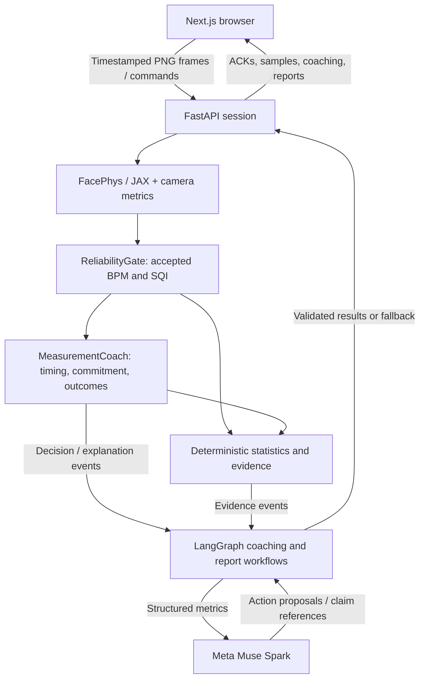

# PulsePilot

A webcam heart-rate research application with live camera input, recorded-video replay, and a labeled synthetic demo. PulsePilot combines frozen FacePhys inference, deterministic signal validation, closed-loop measurement coaching, and evidence-grounded reports. LangGraph coordinates optional Meta Muse Spark assistance around the sensing pipeline.

## Start locally

Requires **Python 3.12**, **uv**, **Node.js 22+**, and **pnpm** using the version declared in `package.json`.

One-time setup, from the repository root:

```sh
pnpm install --frozen-lockfile
uv sync --project backend --frozen
# Skip the checkpoint download if you only want the synthetic demo.
uv run --project backend python scripts/fetch_facephys.py
# Create configuration without replacing an existing .env.
test -e backend/.env || cp backend/.env.example backend/.env
```

Start the backend in one terminal:

```sh
cd backend
uv run uvicorn pulsepilot.app:app --host 127.0.0.1 --port 8000 --workers 1
```

Start the frontend in another terminal, from the repository root:

```sh
pnpm dev
```

Open **http://127.0.0.1:3000**. The backend health endpoint is **http://127.0.0.1:8000/health**. Choose **Explore the demo** to try the complete flow without a camera, checkpoint, or model API key. A real camera or recording session needs the downloaded checkpoint; its first initialization includes JAX warmup. Stop either service with `Ctrl+C`.

### Optional Muse Spark configuration

Set these server-only values in `backend/.env`, then restart the backend:

```dotenv
MODEL_API_KEY=your-meta-api-key
META_MODEL=muse-spark-1.3
AGENT_MODE=assist
```

Starting a session enables Muse Spark coaching and report insights when configured, with no additional setup checkboxes. Without a key or enabled agents, deterministic measurement, guidance, and reports remain available. Keep credentials out of frontend code and `NEXT_PUBLIC_` variables.

## Architecture

The Next.js/React frontend owns capture, preview, charts, session controls, and report export. A persistent FastAPI service owns FacePhys/JAX inference and session resources. LangGraph runs only on coaching and report events; frame processing and live BPM updates continue independently of model requests.



The boundaries are explicit:

- **Sensing and reliability:** FacePhys estimates the pulse signal; deterministic checks decide which heart-rate windows are usable. The model cannot alter thresholds or measurements.
- **Intervention control:** MeasurementCoach commits instructions and owns the five-second baseline, three-second response interval, five-second observation window, and eight-second cooldown. Outcomes use measured pre/post quality and may be inconclusive.
- **Agent orchestration:** Typed event graphs request an eligible action or an explanation, validate identity and applicability, and return a result. Adaptive selection has a six-second planning deadline; explanations and observation retain a 1.5-second deadline, with deterministic fallback. Late, duplicate, and stale decisions cannot replace an active instruction.
- **Reporting:** The server computes statistics and a canonical claim catalogue. Muse can select compatible claim references; the server renders their factual text. The numerical report arrives before optional AI analysis.

One real inference session runs per backend process, with separate temporal state for every connection. Session-local outcome history is bounded; there is no persistent user memory or database. See the [P2 implementation guide](docs/langgraph-p2.md) for graph diagrams, contracts, routing, validation, cancellation, and telemetry.

## Agent modes

Configure `AGENT_MODE` in `backend/.env` or the backend process environment:

| Mode | Behavior |
|---|---|
| `off` | Deterministic coaching and reports; graphs do not execute. |
| `observe` | Graphs collect diagnostics without changing visible coaching decisions or factual reports. |
| `assist` | Rules select actions; timely validated Muse explanations and report selections are allowed. **Default.** |
| `adaptive` | Validated Muse proposals may select a currently eligible action before MeasurementCoach commits it. |

The setup screen uses `meta` coaching automatically. The protocol still supports `passive` and `rules` for direct clients. Adaptive action selection requires `AGENT_MODE=adaptive` and enabled AI for the session.

## Health Insights

Completed native reports include a separate Health Insights section with deterministic guidance, measurement evidence, sources, and accuracy limitations. Simulated or insufficient measurements do not produce personal heart-rate interpretations. The setup leaves activity context unknown; symptom guidance is deterministic and appears before measurement as well as in reports.

Starting a session enables Health Insights selection when Muse Spark is available, sending accepted statistics, quality, provenance, and supplied activity/symptom context. Muse can select only eligible server-authored guidance. Its independent 12-second workflow updates the matching report without delaying numerical results or P2 analysis. JSON export includes the bundle.

See [Health Insights contracts, policy, and evaluation](docs/p3-health-insights.md). Clinical expert review, reference-device accuracy validation, and hardware report adapters remain outstanding.

## Checks and evaluation

From the repository root:

```sh
pnpm check
pnpm build
uv run --project backend pytest -q backend/tests
uv run --directory backend ruff check pulsepilot tests ../scripts
```

With both services running, `pnpm test:e2e` runs browser tests. Install Chromium once with `pnpm exec playwright install chromium` if needed. Camera and recording fixtures use synthetic frames; they do not validate a person's heart rate. Optional checkpoint and policy checks:

```sh
uv run --project backend python scripts/smoke_facephys.py
RUN_FACEPHYS_INTEGRATION=1 uv run --project backend pytest -q backend/tests/test_facephys_integration.py
uv run --project backend python scripts/evaluate_p2.py --output /tmp/pulsepilot-evaluation.json
```

The A/B/C harness compares deterministic, assisted, and adaptive policies on seeded synthetic traces without remote model requests. Recorded results and the separate opt-in live Muse check are in the [verification record](docs/verification.md); the [evaluation protocol](docs/evaluation.md) distinguishes fixture behavior, recordings, human sessions, and reference-device measurements.

## Deployment

The included `docker compose up --build` stack serves the frontend and persistent inference backend through Caddy at http://localhost:8080. Compose passes `AGENT_MODE` to the backend and defaults to `assist`. It reads `MODEL_API_KEY` from the shell or Compose environment, not `backend/.env`.

For a separate frontend host, build with `NEXT_PUBLIC_BACKEND_URL=https://your-inference-host` and configure the backend's exact `ALLOWED_ORIGINS`. Keep physiological inference in the persistent Python service. See the [deployment runbook](docs/deployment.md) for HTTPS/WSS, proxy configuration, and production startup.

## Documentation

- [System architecture](docs/architecture.md)
- [LangGraph P2 workflows and contracts](docs/langgraph-p2.md)
- [Coaching and report agent design](docs/agent-design.md)
- [Backend setup and WebSocket protocol](docs/backend-service.md)
- [FacePhys integration, heatmap, and waveform](docs/facephys-integration.md)
- [Frontend experience](docs/web-experience.md)
- [Evaluation protocol](docs/evaluation.md)
- [Verification results and remaining limits](docs/verification.md)
- [P4 real-camera self-test and capture diagnostics](docs/p4-real-camera.md)

## Privacy and limits

Starting a camera or recording session sends video frames to the configured inference service, which discards them after processing. When available, Muse receives numerical summaries, intervention history, and supplied activity/symptom context; it never receives images. Reports stay in browser memory for the page session and can be exported as JSON or printed. External tracing is disabled.

PulsePilot is a research application, not a medical device. Signal periodicity and before/after quality changes do not establish heart-rate accuracy or causal coaching benefit. Real-camera validation is limited to the [three-session local self-test](docs/p4-real-camera.md); low-light robustness, synchronized reference accuracy, multi-user benefit, and durable hosting remain unverified. The pinned upstream source and checkpoint have distinct licensing considerations; see [FacePhys integration](docs/facephys-integration.md#licensing-limitation).
