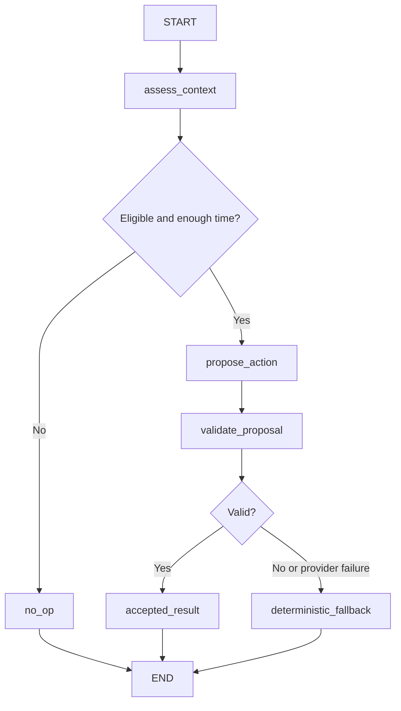
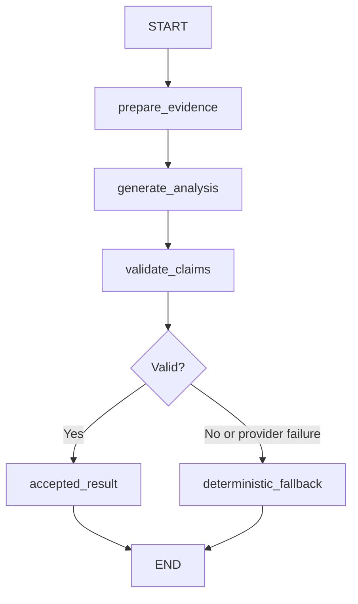

# PulsePilot P2: event-driven LangGraph orchestration

Implemented October 27, 2026. This document is the current P2 reference; P1 verification files describe historical runs. Physiological sensing, reliability thresholds, numerical reporting, and intervention timing remain deterministic. LangGraph 1.2.18 is locked by `backend/uv.lock` and runs on the existing Python 3.12 backend.

## Implementation map

P1 already provided pre-commit Muse selection, strict server-authored report claims, measured intervention outcomes, and bounded within-session history. P2 wraps those interfaces in two compiled event graphs, introduces four explicit deployment modes, strengthens contract validation, and adds session-scoped execution, cancellation, telemetry, and reproducible policy evaluation.

| Files | Responsibility |
|---|---|
| `backend/pulsepilot/orchestration/contracts.py`, `state.py` | Strict Pydantic events, trusted context, model proposals, validated outputs, and TypedDict graph channels |
| `orchestration/graph.py` | Graph construction, pure result nodes, conditional routing, bounded provider failure handling |
| `orchestration/provider.py` | Existing Meta HTTP adapter, structured outputs, invocation timeout, token usage |
| `orchestration/tools.py`, `validation.py` | Read-only projections, canonical actions, identity checks, exact claim/evidence binding, server rendering |
| `orchestration/service.py`, `telemetry.py` | Stable async application interface, mode configuration, deadlines, session lifecycle, safe local diagnostics |
| `backend/pulsepilot/app.py` | WebSocket task dispatch, final commitment/enrichment checks, immediate numerical report, disconnect-aware optional analysis |
| `backend/pulsepilot/coaching.py` | Shared context construction, final deterministic eligibility/commitment, capture-timeline expiry |
| `backend/pulsepilot/schemas.py`, `reports.py`, `agents.py` | Strict domain contracts, bounded factual claim types, exported provenance, reused HTTP adapter and token extraction |
| `lib/types.ts`, `components/pulsepilot.tsx`, `components/report.tsx` | Accurate consent copy, separate action/explanation provenance, validated report attribution |
| `backend/tests/test_graph*.py`, `test_adaptive_coaching.py`, `test_p2_evaluation.py` | Routing, adversarial, session/lifecycle, policy, telemetry, and evaluation tests |
| `tests/coaching.spec.ts`, `tests/async-report.spec.ts` | Mode/consent UI, committed-action preservation, report lifecycle |
| `scripts/evaluate_p2.py`, `scripts/verify_sensing_agent.py` | Offline A/B/C fixture evaluation, exported report summaries, explicit opt-in live Meta verification |

## Architecture and graphs

The frame path remains `browser → FastAPI → FacePhys/JAX → ReliabilityGate → sample/ACK`. No graph node receives a frame, landmark set, bounding box, waveform, estimator, lock, or mutable coach. Samples continue while a graph awaits the model. Each WebSocket owns its service and coach; graph execution has no persistent checkpoint or cross-session memory.





The assessment/preparation nodes establish explicit workflow entry points; the service has already validated and snapshotted their inputs through the deterministic tools. Generation nodes call the provider once. Validation nodes return `ValidationResult`; conditional edges select accepted or deterministic result nodes. Missing consent and face/cadence safety corrections skip provider invocation. A coaching event with no candidates or less than eight measurement seconds remaining returns `no_op`.

Node input is `AgentState.event`, a strict `CoachEvent` or `ReportEvent`. Node updates contain only proposal, status, validation, model latency, or `GraphOutcome`. `build_graphs(provider)` compiles the two workflows independently of execution. The implementation uses the installed [`StateGraph` API](https://reference.langchain.com/python/langgraph/graph/state/StateGraph), conditional edges, and `ainvoke`; it does not add autonomous tool loops.

## Contracts, tools, and trust

`CoachEvent` binds a UUID session, UUID event, graph version, monotonic issue time, measurement timestamp, consent, purpose, and `CoachContext`. Context contains a fixed scalar `QualityContext`, canonical eligible actions, remaining duration, proposal ID, and at most six completed outcomes. An explanation event also identifies its committed intervention. The action catalogue remains in `sensing.py`; its instruction and issue must match the offered action ID exactly.

`ReportEvent` carries an `EvidenceBundle`: deterministic statistics, evidence strings, the canonical bounded claim catalogue, and the deterministic fallback analysis. It excludes report samples. Model proposals are separate `CoachProposal` and `AnalysisProposal` contracts. All domain and orchestration models reject extra fields, nonfinite numbers, and type coercion. The service revalidates and deep-snapshots nested models, including objects created with `model_copy`.

The tools are explicit read-only functions: `get_quality_context`, `get_eligible_actions`, `get_intervention_history`, `get_session_statistics`, and `get_report_evidence`. They have no filesystem, shell, unrestricted network, or intervention-mutation capability.

For coaching, the server validates session/event identity, action/issue agreement, current eligibility, canonical explanation, and supported reasons. `try_alternative` requires an actual different unchanged/worsened prior action. A correct action ID paired with contradictory text fails. Only the predefined `wait` reason can abstain. Face/cadence safety actions remain deterministic.

For reports, Muse selects references containing `claim_id`, `claim_type`, and `evidence_id` for their original section. Duplicate, missing, mismatched, or fabricated references fail. The server renders the canonical text; the output schema has no free factual prose or statistics field. Claim families distinguish signal availability, accepted-estimate trends, quality/measurement limitations, recommendations, intervention counts, and each intervention outcome. Empty reports offer `signal_unavailable`; unsuccessful interventions never offer an improvement claim. The existing exact-copy P1 analyst remains a compatibility API; the app uses the graph service.

## Modes and consent

Set `AGENT_MODE` on the backend process. The default is `assist`; adaptive selection requires an explicit configuration change.

| Mode | Coaching with `meta` preference | Report behavior |
|---|---|---|
| `off` | Immediate deterministic action; no graph execution | Deterministic only |
| `observe` | Immediate deterministic action; graph output is diagnostic only | Deterministic analysis remains visible; optional graph diagnostics |
| `assist` | Immediate deterministic action; a timely validated explanation may enrich the same action | Immediate deterministic report, then validated optional selection |
| `adaptive` | Eligible proposal before commitment; validated choice or deterministic fallback | Immediate deterministic report, then validated optional selection |

Across all modes, `passive` never produces an intervention. `rules` never requests a model coaching decision or explanation. Separately consented report analysis may still run for passive/rules sessions in enabled modes. Every remote request requires explicit per-session AI consent and a configured server key, including in observe mode. Consent for inference-service frames does not authorize transfer to Meta. No images are sent to Meta at all.

Without consent, a key, network access, or a valid response, deterministic sensing/coaching/reporting remains usable. Off mode does not construct graphs. Unknown `AGENT_MODE` values produce a configuration error. `/health` exposes the configured mode; `ready` adds mode and an ephemeral session ID without changing existing event types.

## Async lifecycle and intervention control

`OrchestrationService.run_coach_event(event)` and `run_report_event(event)` return typed `GraphOutcome` values. The service rejects cross-session, duplicate, future, and expired events, bounds its seen-event registry to 512, and keeps at most 256 safe telemetry records. A completed measurement rejects future coach events while allowing its final report event. Closing the session cancels and drains every running event. Cancellation propagates through the graph, HTTP task, and client; it does not become a fallback result.

The complete coaching graph has a **1.5-second application deadline**, including compilation and validation. The provider independently has a ten-second invocation timeout; the reused HTTP client has twelve-second total/four-second connection network limits. Report execution has a twelve-second application deadline. These are separate limits. No model task acquires the FacePhys inference lock.

Only the WebSocket sample handler applies results. It matches the live proposal or committed intervention, rechecks current eligibility, fresh samples, safety conditions, session duration, and absence of an active overlapping action. A model proposal more than 1.5 capture-timeline seconds old falls back to the current rules candidate. Sample gaps, face loss, finish, and disconnect invalidate pending selection. Explanation enrichment must match the same still-active action within its three-second response window. Observe results never change the coach. Graph completion itself cannot send an instruction or mutate statistics.

The coach preserves five seconds of persistence/baseline, three seconds for user response, a disjoint five-second post window, and eight seconds of cooldown. Intervention timing begins at actual commitment. Each comparison requires at least eight samples spanning 3.5 seconds and eight nonmissing SQI values. A SQI change of at least 0.08 classifies improved/worsened; missing or interrupted observations are inconclusive. Current candidates and up to six measured outcomes guide subsequent choices. There is no persistent user profile or model training.

Before optional analysis, the backend closes the estimator, releases capacity, cancels coaching tasks, builds the numerical report, and sends it immediately. The report request then races a disconnect listener so cancellation/restart does not wait for model completion. All terminal paths retain the existing cancellation-safe worker drain and inference-lock release.

## Provenance, privacy, and deployment

Every applied graph decision/enrichment records its event ID, graph version, model/graph latency, action source, explanation source, and status on the intervention. Reports retain their agent mode, safe typed telemetry, and a graph event ID/version for optional interpretation. Observe-mode report diagnostics remain local rather than triggering another visible report update. The legacy `source` field mirrors the action source. A validated graph proposal is not itself proof of intervention commitment; the coach remains authoritative.

Telemetry records event/session IDs, type/version, route/status, validation/fallback reason, model identifier, latency, and token/request counts when supplied by Meta. It excludes context, analysis, explanations, camera data, waveform, and secrets. It is local and bounded. External LangSmith tracing is explicitly disabled even if inherited tracing environment variables are set. No tracing credentials, checkpointer, database, broker, or extra service is required.

The existing persistent FastAPI/WebSocket deployment and Next.js proxy remain intact. The Dockerfile already installs `backend/uv.lock` with `uv sync --frozen --no-dev`, so it includes LangGraph. Docker execution could not be verified because the local daemon was unavailable. Server-only `MODEL_API_KEY` and `META_MODEL` remain unchanged; do not expose them through `NEXT_PUBLIC_` variables.

## Run locally

From the repository root:

```sh
pnpm install
cd backend
uv sync
# For a new setup only: cp .env.example .env
# Put MODEL_API_KEY and optional META_MODEL in the ignored backend/.env.
AGENT_MODE=assist uv run uvicorn pulsepilot.app:app --host 127.0.0.1 --port 8000
```

In another terminal at the root:

```sh
pnpm dev
```

Use `AGENT_MODE=off`, `observe`, `assist`, or `adaptive` in the same backend command. In the UI choose passive/rules/meta and explicitly opt into numerical-metric transfer as desired. Real camera/recording inference requires the existing FacePhys checkpoint (`uv run scripts/fetch_facephys.py` from the root for a new setup). Simulation needs no checkpoint or key.

## Evaluation and observed verification

```sh
cd backend
uv run pytest -q
uv run ruff check pulsepilot tests ../scripts
RUN_FACEPHYS_INTEGRATION=1 uv run pytest -q tests/test_facephys_integration.py
uv run python ../scripts/smoke_facephys.py
uv run python ../scripts/evaluate_p2.py --seed 27 --repetitions 3 --output ../docs/p2-evaluation.json
# Explicit opt-in real Meta calls with synthetic metrics only:
uv run python ../scripts/verify_sensing_agent.py --live --output ../docs/p2-live-verification.json
```

From the root, run `pnpm check`, `pnpm build`, and `pnpm test:e2e` with both services running. `PULSEPILOT_TEST_URL` can select a separate frontend. Unit tests clear live credentials by default; live verification is separate.

The fixture harness compares A: deterministic, B: rules with explanations, and C: pre-commit adaptive selection on identical seeded traces passed through the actual ReliabilityGate, with randomized trial order. It records SQI/usability/stability, completion/outcomes, pre/post changes, acceptance/rejection/fallback rates, graph/provider latency, usage where available, policy CPU time, and peak traced Python allocation. `--reports A.json B.json C.json` summarizes actual exported sessions, preserving their camera/recording/simulation labels and safe run telemetry. Optional `--input-usd-per-million` and `--output-usd-per-million` supply operator-verified price assumptions for observed token usage; estimates exclude unknown canceled-call billing. Operator-controlled counterbalancing, consent, synchronized references, and identical hardware/settings are required for human trials. Missing telemetry/cost/throughput/reference data remain unavailable rather than estimated.

Observed results are stored in [p2-evaluation.json](p2-evaluation.json) and [p2-live-verification.json](p2-live-verification.json):

- Nine synthetic fixture trials: all policies had mean SQI about 0.469, usable fraction 0.322, and first stable signal at 41 seconds. A/B first chose darkness correction; C first chose motion correction. Each scripted session produced two unchanged and one improved association. The shared trace fixes quality independently of instructions, so this is **not a benefit comparison**. Fixture graph means were approximately 4–5 ms with allocation tracing enabled; no remote requests were made.
- Live Muse over synthetic metrics: two coaching requests exceeded the 1.5-second budget and safely used rules. The next request received measured outcome history. The final report validated in about 3.65 seconds, with Meta reporting 1,868 input and 478 output tokens. The run establishes live schema/report integration and timeout fallback, not timely live adaptive selection. Unknown billing for canceled requests and absent price inputs prevent an API cost estimate.
- Frozen FacePhys smoke: 360 finite BVP outputs, approximately 798 model steps/second after 9.4-second warmup; blank frames had no accepted BPM. The two opt-in real-checkpoint integration tests passed on synthetic frames.
- Backend, TypeScript, production build, and browser verification results are recorded in [verification.md](verification.md#p2-langgraph-verification).

P2 Core (M1–M4) is verified within the defined automated/local scope. P2 Extended (M5) is implemented and fixture-verified, but only partially empirically verified: live coaching selection did not meet the initial latency budget in this run, and human benefit, physical-camera performance, controlled less-than-five-percent inference-throughput regression, reference HR accuracy, Docker execution, and durable deployment remain unverified. Increased SQI never establishes increased HR accuracy. No persistent health history or infrastructure was added.
